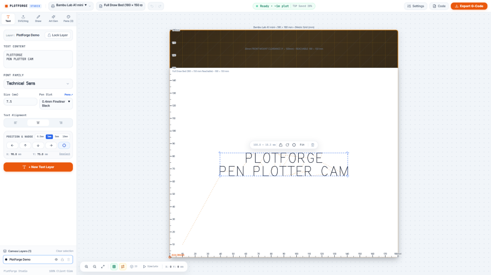

<div align="center">

# PlotForge Studio 🖋️

### Professional Pen Plotter CAM & Vector Design Studio for 3D Printers
**Turn your Bambu Lab A1 Mini, A1, Ender-3, or CoreXY into a high-precision multi-pen plotter in 60 seconds.**

[](https://github.com/kumawat007/PlotForge/actions)
[](https://nextjs.org)
[](https://www.typescriptlang.org)
[](https://vitest.dev)
[](#-security--gdpr-compliance)
[](LICENSE)

<br />

<p align="center">
  <a href="http://localhost:3000"><b>🚀 Launch Studio</b></a> •
  <a href="https://makerworld.com/en/@kumawat007"><b>📦 Download 3D Mounts</b></a> •
  <a href="#-quick-3-step-workflow"><b>⚡ Quick Start</b></a> •
  <a href="#-why-plotforge"><b>💡 Why PlotForge</b></a> •
  <a href="https://buymeacoffee.com/kumawat007"><b>☕ Sponsor Project</b></a>
</p>

<br />

<a href="http://localhost:3000">
  
</a>

<p align="center"><i>A modern, Linear/Apple-inspired CAM interface featuring real-time metric rulers, safety boundary visualization, multi-pen layers, and 2-Opt TSP toolpath simulation.</i></p>

</div>

---

## ⚡ Quick 3-Step Workflow

```
1. 3D Print Mount           2. Design in PlotForge          3. Export & Plot
┌─────────────────────┐     ┌─────────────────────┐         ┌─────────────────────┐
│ Snap PIP Mount onto │ ──▶ │ Type Single-Stroke  │  ───▶   │ Download .gcode,    │
│ Bambu Lab Toolhead  │     │ Text, SVGs or Photos│         │ Insert Pen, & Draw! │
└─────────────────────┘     └─────────────────────┘         └─────────────────────┘
```

1. **3D Print the Mount**: Download the 1-piece Print-in-Place (PIP) snap-on pen mount from [MakerWorld @kumawat007](https://makerworld.com/en/@kumawat007)
2. **Design Your Canvas**: Open PlotForge, type single-stroke Hershey text, drag-and-drop vector SVGs, or vectorize photos.
3. **Export & Draw**: Click **Export G-Code**. Transfer via SD card or Wi-Fi FTPS, insert your pen, and hit Print!

---

## 💡 Why PlotForge?

Standard 3D slicers and generic laser software were never designed for pen plotters. PlotForge solves the common pain points out-of-the-box:

| Capability | Generic 3D Slicers | Inkscape Plugins | LaserGRBL | **PlotForge Studio** |
| :--- | :---: | :---: | :---: | :---: |
| **Zero Installation / Browser-Native** | ❌ App download | ❌ Python scripts | ❌ Windows only | **✅ 100% Browser Web App** |
| **Real Single-Stroke Handwriting** | ❌ Hollow outlines | ⚠️ Limited | ❌ No | **✅ Native Hershey + Cursive** |
| **Bambu Lab A1 Mini Pre-Configured** | ❌ No pen offsets | ❌ Manual math | ❌ No | **✅ 30mm Offset & Bed Limit** |
| **Multi-Color Pen Changes** | ⚠️ Complex G-code | ❌ Manual split | ❌ No | **✅ Automated `M400 U1` Pause** |
| **Snake Infill for Solid Artwork** | ❌ Inefficient travel | ⚠️ Prone to tears | ❌ Raster burn | **✅ Continuous Boustrophedon** |
| **Path Distance Optimization (TSP)** | ⚠️ Basic nearest | ❌ Slow Python | ⚠️ Basic | **✅ 2-Opt TSP Optimizer (>40%)** |
| **Data Privacy & Telemetry** | ⚠️ Telemetry sent | ✅ Local | ✅ Local | **✅ 100% Client-Side (GDPR)** |

---

## 🌟 Core Features

### ✍️ Single-Stroke Typography & Cursive Engine
Traditional computer fonts create hollow double outlines when plotted with a pen. PlotForge includes **native Hershey single-stroke fonts** (CAD Drafting, Classical Serif, Executive Italic, Modern Round, and Hershey Script) with intelligent cursive ligature bridging for seamless, fluid handwriting.

### 🖼️ PicSVG Photo Vectorizer Studio
Drop any raster image (`.png`, `.jpg`, `.webp`) and convert it into crisp plotter paths using **19 dedicated filters** (Inkscape Smooth Bezier, Canny Edge, Otsu Clean, and Artistic Woodcut) paired with continuous **snake infill hatching** for solid areas.

### 🎨 Dedicated Canvas Layers & Multi-Pen Colors
Manage artwork through an interactive Layers Dock:
- **Instant Layer Lock (🔒)**: Safeguard artwork against accidental movement or deletion.
- **Show / Hide (👁️)**: Toggle individual layers without losing positioning.
- **Multi-Pen Sequencing**: Assign distinct pen slots (`0.2mm Fineliner`, `0.4mm Gel Pen`, `0.7mm Marker`). PlotForge automatically generates Bambu toolhead pauses (`M400 U1`) and waste-chute parking between colors.

### ⚡ 2-Opt Traveling Salesperson (TSP) Path Optimization
Reduces plotting time and pen wear by reordering thousands of disconnected vectors into the shortest continuous trajectory, cutting air-travel moves by **40% or more**.

---

## 🖨️ Hardware & Kinematic Calibration

### Official Bambu Lab A1 Mini Snap Mount
- **Nozzle-to-Pen Nib Offset**: $\Delta X = 0\text{ mm}$, $\Delta Y = -30\text{ mm}$ (Pen sits 30mm forward of the hotend nozzle).
- **Hardware-Safe Reachable Envelope**: $180 \times 150\text{ mm}$.
- **Clearance Boundary**: The bed region $Y > 150\text{ mm}$ is clearly demarcated with safety hatching to prevent front-mount frame collisions.
- **Elevated Drawing Plane**: Hotend nozzle remains elevated at $Z = 10\text{ mm}$ during plotting, completely preventing bed contact or heat damage.

### Recommended Pen & Paper Kit
- **Fineliner Pens**: Sakura Pigma Micron (0.2mm / 0.4mm), Staedtler Triplus.
- **Gel Pens**: Sakura Gelly Roll (0.5mm / 0.8mm) — stunning on black and kraft paper.
- **Paper**: 120gsm+ Smooth Bristol board or heavy cardstock, secured with blue painter's tape.

---

## ⌨️ Productivity Keyboard Shortcuts

| Shortcut | Action |
| :--- | :--- |
| <kbd>Space</kbd> | Toggle toolpath simulation playback |
| <kbd>Ctrl</kbd> + <kbd>Z</kbd> | Undo canvas modification |
| <kbd>Ctrl</kbd> + <kbd>Y</kbd> / <kbd>Shift</kbd> + <kbd>Ctrl</kbd> + <kbd>Z</kbd> | Redo canvas modification |
| <kbd>Arrow Keys</kbd> | Nudge selected layer by **1 mm** |
| <kbd>Shift</kbd> + <kbd>Arrow</kbd> | Large nudge by **10 mm** |
| <kbd>Alt</kbd> + <kbd>Arrow</kbd> | Precision micro-nudge by **0.1 mm** |
| <kbd>Delete</kbd> / <kbd>Backspace</kbd> | Delete selected layer |
| <kbd>Esc</kbd> | Deselect active element |

---

## 🛡️ Security & GDPR Compliance

PlotForge is architected strictly under **Privacy-by-Design** principles:
- **Zero Server Processing**: 100% of vector operations, image vectorization, font rendering, and G-code synthesis run client-side inside your browser's Web Worker threads.
- **Zero Remote Storage**: Your photos, artwork, and CAD files never leave your device.
- **Zero Tracking**: No tracking cookies, third-party analytics, or behavioral telemetry.

---

## 💻 Developer Quick Start

```bash
# 1. Clone repository
git clone https://github.com/kumawat007/PlotForge.git
cd PlotForge

# 2. Install dependencies
npm install

# 3. Launch development server
npm run dev
```

Open [http://localhost:3000](http://localhost:3000) in your browser.

```bash
# Run unit test suite (84 tests across 15 suites)
npm test

# Run strict TypeScript verification
npx tsc --noEmit

# Build production static export (out/)
npm run build
```

---

## 🤝 Community & Creator Support

PlotForge is free, open-source software built for the global maker community.

- **Download 3D Printable Mounts**: [MakerWorld @kumawat007](https://makerworld.com/en/@kumawat007)
- **Support Project Development**: [Buy Me a Coffee @kumawat007](https://buymeacoffee.com/kumawat007)
- **Contribute**: Read our [Contributing Guide](CONTRIBUTING.md) and [Code of Conduct](CODE_OF_CONDUCT.md).

---

## 📄 License

PlotForge is licensed under the **[MIT License](LICENSE)**.
